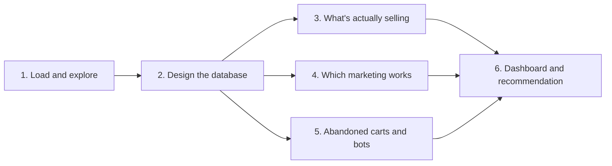

# Breaking Games: SQL & Database Architecture

Six messy Shopify and Meta exports turned into one connected SQLite database and a Q4 dashboard that helps Breaking Games decide **what to print and where to spend before Black Friday**.

Built during the Extern SQL & Database Architecture Externship with Breaking Games (Nov 2026). Claude was the SQL co-pilot: Claude did the typing, I did the thinking. This repo shows the thinking.

> **Start here:** [`PRD.md`](PRD.md) is the one living proposal. Every other file supports a decision in it.

## Who it's for

- **Mike Bradley, Head of E-Commerce** (scenario character): commits holiday print quantities and needs to know which products actually sell.
- **Jess Walker, Senior Marketing Ops** (scenario character, mentor): needs to know which marketing channels earn their spend.
- **Reviewers and hiring managers**: can audit every number back to a rule, and every rule back to a decision.

## From six CSVs to one recommendation



| Project | The question | What I decided (the judgment) | What Claude did | Artifact |
|---|---|---|---|---|
| 1. Load and explore | What does each table actually hold, and how far can I trust it? | Which quirks to fix, which to flag, and which questions to take to the mentor | Profiled columns, ran counts | [`docs/data-quality-report.md`](docs/data-quality-report.md), [`sources.json`](sources.json) |
| 2. Design the database | How do six tables with no shared ID become one model? | Product key, channel mapping, grain of each table | Drafted DDL and mapping queries | [`docs/decision-log.md`](docs/decision-log.md) D-03, D-08 |
| 3. What's actually selling | Which products should get print priority? | Revenue vs units as the "top seller" measure; the time window every claim covers | Wrote ranking queries | [`docs/metric-definitions.md`](docs/metric-definitions.md) |
| 4. Which marketing works | Where does marketing spend earn its keep? | Channel-level attribution only; never mix Meta `results` units | Wrote channel rollups | D-02, D-07 |
| 5. Abandoned carts and bots | How much cart value is real demand vs noise? | The bot rule and how many carts it removes | Wrote detection queries | D-09 |
| 6. Dashboard and recommendation | What should leadership do this week? | Fewer tiles, each tied to a decision and a threshold | Built the HTML dashboard | [`docs/dashboard-decision-spec.md`](docs/dashboard-decision-spec.md) |

The step-by-step story, with what changed my mind along the way: [`WALKTHROUGH.md`](WALKTHROUGH.md).

## How this repo works

- **One proposal, rewritten, never appended.** `PRD.md` always holds the current recommendation. Its history lives in git, not in stacked "v2" sections.
- **Every choice with a real alternative goes in the decision log**, with the trigger that would reopen it.
- **Every number keeps its receipt:** the query that produced it, the table it came from, and the date it was run.
- **What I chose not to do is written down too.** [`rejected.md`](rejected.md) lists each cut and why.
- **Claude is held to written rules.** [`CLAUDE.md`](CLAUDE.md) is what every co-pilot session reads first, so the same data traps aren't relearned each time.

## Repo map

```
PRD.md                      The proposal: problem, users, priorities, non-goals, success
WALKTHROUGH.md              Project by project, what I did and what I learned
CLAUDE.md                   Rules for the SQL co-pilot
rejected.md                 Out of scope, with reasons
sources.json                Every source table: rows, grain, time window, trust
docs/
  decision-log.md           Dated decisions, options, trade-offs, reopen triggers
  data-quality-report.md    What's wrong in each table and what the business shouldn't trust yet
  metric-definitions.md     Each KPI: formula, grain, owner, caveat
  dashboard-decision-spec.md Each tile: question, decision, threshold
sql/
  00_verification.sql       Row counts and sanity checks
  01_schema.sql             (Project 2)
  02_top_sellers.sql        (Project 3)
  03_channels.sql           (Project 4)
  04_carts_and_bots.sql     (Project 5)
dashboard/                  (Project 6) HTML dashboard
```

## Data

The `.db` file and source CSVs are **not** in this repo until Extern confirms they can be published. The schema, queries and documentation are. Customer data in the source is anonymized.

## Tools

SQLite · DB Browser for SQLite · Claude (SQL co-pilot) · Git
