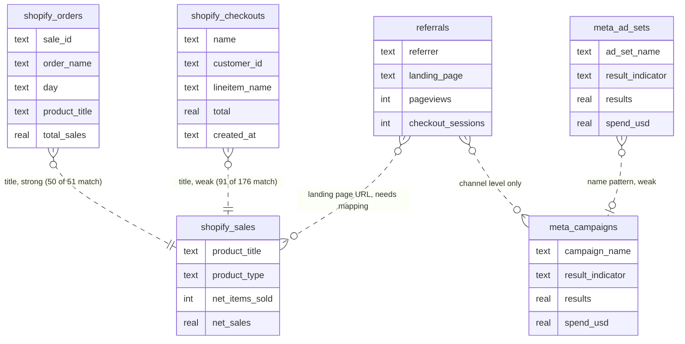

# Entity-Relationship Diagrams

## Current State: Six Unlinked Tables

As loaded, no table shares a key with another. The dotted lines are the links that can be built in Project 2, and how strong each one is.

## Target Design

*Added in Project 2: `dim_product` with a stable `product_id`, a title-mapping table, and `dim_channel`. See D-03 and D-08 in [`../design-decisions.md`](../design-decisions.md).*
